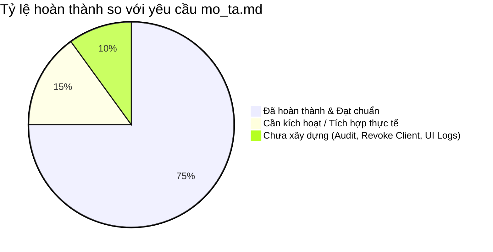

# Checklist Các Công Việc Còn Thiếu & Kế Hoạch Hoàn Thiện

> **Tài liệu tham chiếu:** [mo_ta.md](file:///Users/nguyenhuynh/Documents/projects/gateway-service-and-vault/mo_ta.md)  
> **Ngày lập:** 23/11/2026  
> **Tiến độ dự án hiện tại:** ~75% hoàn thành (Đã có Modular Monolith, Vault In-Memory Hot-Reload, SSO IdP, Virtual Keys & Client mTLS, Upstream Services Catalog, Project-Service Binding, Unified Ingress Gateway).

---

## 📌 Tổng Quan Tiến Độ & Phân Hạng Công Việc Còn Thiếu



### Bảng tóm tắt các hạng mục còn thiếu theo mức độ ưu tiên:

| Mức độ | Hạng mục | Phạm vi | Mô tả ngắn |
| :---: | :--- | :---: | :--- |
| **P1** | **Kích hoạt mTLS & Identity Binding tại APISIX** | Infra / BE | Bật filter Lua trong APISIX container để chặn triệt để khi thiếu Virtual Key hoặc sai mTLS. |
| **P1** | **Chức năng Thu hồi Thiết bị (Revoke Client)** | BE / FE | Vô hiệu hóa máy tính/máy chủ bị mất/nghỉ việc, tự động revoke toàn bộ Virtual Key liên quan. |
| **P2** | **Thực thi Quota & Rate Limit thực tế tại Gateway** | Infra / BE | Cấu hình plugin `limit-req` / `limit-count` trên APISIX và atomic counter theo ngày. |
| **P2** | **Hệ thống Nhật ký Kiểm toán & Cảnh báo (FR-12)** | BE / FE | Ghi log vào `audit_events`, xây dựng API và trang Web UI xem Audit Logs & Cảnh báo vi phạm. |
| **P3** | **Tải Bundle Chứng chỉ & SDK Onboarding** | FE | Tải file `.crt`/`.key` khi tạo Client, hướng dẫn tích hợp SDK mẫu ngay trong tab Vault. |
| **P4** | **Tự động vô hiệu hóa theo tài khoản SSO** | BE | Đồng bộ trạng thái vô hiệu hóa tài khoản từ DUT AI Manage sang Device Identity. |

---

## 📝 CHECKLIST CHI TIẾT CÁC CÔNG VIỆC CẦN THỰC HIỆN

### Giai đoạn 1: Thực thi Bảo mật Cốt lõi & Gateway Enforcement (Ưu tiên P1 - Critical)

Mục tiêu: Đảm bảo 100% request gọi tới Upstream Service (`/services/*`) phải đi qua cổng bảo mật mTLS, xuất trình chứng chỉ hợp lệ và Virtual Key khớp chính xác với Dự án và Thiết bị.

- [ ] **Task 1.1: Mount & Kích hoạt Custom Lua Plugin trong APISIX Container**
  - **Mục tiêu:** Cho phép APISIX nạp và chạy mã nguồn `identity-binding-filter.lua`.
  - **File tác động:**
    - `docker-compose.yml`: Mount `./apps/apisix/plugins:/usr/local/apisix/plugins:ro`.
    - `apps/apisix/conf/config.yaml`: Thêm `extra_lua_path: "/usr/local/apisix/plugins/?.lua"` và khai báo `identity-binding-filter` vào danh sách `plugins`.
  - **Tiêu chí nghiệm thu:** APISIX khởi động nhận diện thành công plugin `identity-binding-filter` mà không báo lỗi syntax.

- [ ] **Task 1.2: Bổ sung trích xuất Service Slug và Service Scoping trong Lua Filter**
  - **Mục tiêu:** Lua filter phải gửi cả `service_slug` sang Control Plane để kiểm tra xem Dự án có quyền gọi Service đó không (`is_service_allowed`).
  - **File tác động:**
    - `apps/apisix/plugins/identity-binding-filter.lua`: Bóc tách slug từ URI (ví dụ: `^/services/([^/]+)/`) và gửi kèm vào body JSON `{ raw_virtual_key, cert_fingerprint, project_id, service_slug }`.
  - **Tiêu chí nghiệm thu:** Request gọi dịch vụ ngoài danh sách Allowlist của Dự án bị chặn ngay với `HTTP 403 Forbidden`.

- [ ] **Task 1.3: Tự động đính kèm `identity-binding-filter` khi sinh Route trên APISIX**
  - **Mục tiêu:** Mọi route upstream khi được tạo mới hoặc đồng bộ khởi động đều có filter bảo vệ.
  - **File tác động:**
    - `modules/gateway/client/apisix_client.py`: Trong hàm `sync_upstream_service_route()`, thêm `identity-binding-filter` vào `plugins` dictionary của payload gửi tới APISIX Admin API.
  - **Tiêu chí nghiệm thu:** `curl http://localhost:9080/services/llm/models` khi không có header `X-Virtual-Key` hoặc không có mTLS sẽ bị trả về `401/403` ngay lập tức.

- [ ] **Task 1.4: Triển khai Chức năng Thu hồi Thiết bị (Revoke Client Backend)**
  - **Mục tiêu:** Cho phép thu hồi định danh phần cứng (Device/Machine Identity) và tự động thu hồi toàn bộ Virtual Key của thiết bị đó.
  - **File tác động:**
    - `modules/gateway/domain/interfaces.py`: Bổ sung `revoke_client(client_id: str) -> bool`.
    - `modules/gateway/repository/gateway_repository.py`: Triển khai cập nhật `is_revoked = True` và gọi `revoke_active_keys(client_id, project_id)`.
    - `modules/gateway/use_cases/revoke_client.py`: Tạo mới `RevokeClientUseCase`.
    - `modules/gateway/di.py`: Đăng ký DI provider cho `RevokeClientUseCase`.
    - `apps/api/routers/gateway_router.py`: Endpoint `POST /api/v1/gateway/clients/{client_id}/revoke`.
  - **Tiêu chí nghiệm thu:** Khi gọi revoke client, trạng thái đổi thành `is_revoked = True`, tất cả virtual keys của client đó chuyển thành `REVOKED`. Các request tiếp theo từ client đó bị từ chối `403`.

- [ ] **Task 1.5: Giao diện Web UI Thu hồi Thiết bị**
  - **Mục tiêu:** Quản trị viên có thể bấm nút thu hồi trên bảng Client.
  - **File tác động:**
    - `web/src/features/clients/services/client-service.ts`: Bổ sung `revokeClient(id: string)`.
    - `web/src/features/clients/hooks/use-clients-queries.ts`: Bổ sung mutation `useRevokeClientMutation`.
    - `web/src/features/clients/components/clients-table.tsx`: Nút "Thu hồi thiết bị" kèm xác nhận cảnh báo.
  - **Tiêu chí nghiệm thu:** Admin bấm thu hồi, badge đổi sang `REVOKED` màu đỏ, không thể tạo Virtual Key mới cho thiết bị này.

---

### Giai đoạn 2: Thực thi Quota & Rate Limit thực tế tại Gateway (Ưu tiên P2 - High)

Mục tiêu: Đảm bảo một client hoặc dự án gọi quá số lượng request (RPM hoặc ngày) sẽ bị Gateway điều tiết với mã `HTTP 429 Too Many Requests`.

- [ ] **Task 2.1: Kích hoạt APISIX Rate Limiting Plugin (`limit-req` hoặc `limit-count`)**
  - **Mục tiêu:** Áp dụng giới hạn `rate_limit_rpm` đã cấu hình cho từng Upstream Route.
  - **File tác động:**
    - `modules/gateway/client/apisix_client.py`: Bổ sung plugin `limit-count` vào route payload:
      ```json
      "limit-count": {
        "count": rate_limit_rpm,
        "time_window": 60,
        "rejected_code": 429,
        "key_type": "var",
        "key": "http_x_virtual_key"
      }
      ```
  - **Tiêu chí nghiệm thu:** Gửi liên tiếp quá số request RPM quy định bằng cURL/ApacheBench -> APISIX trả về `HTTP 429 Too Many Requests`.

- [ ] **Task 2.2: Kiểm soát Hạn mức Ngày (`quota_daily`) qua Redis Atomic Counter**
  - **Mục tiêu:** Tích lũy số lượt gọi trong ngày theo cặp `(Project, Client, Service)`.
  - **File tác động:**
    - `modules/gateway/use_cases/verify_identity_binding.py` hoặc Lua plugin: Tăng biến đếm Redis `INCR gateway:quota:{project_id}:{date}` với TTL 24h.
    - Trả về lỗi `QuotaExceededError` nếu vượt quá `quota_daily`.
  - **Tiêu chí nghiệm thu:** Khi đạt trần quota ngày, hệ thống từ chối các request tiếp theo và trả về `HTTP 429`.

- [ ] **Task 2.3: Hiển thị Mức Sử Dụng Quota trên Giao diện Web UI**
  - **Mục tiêu:** Tech Lead theo dõi trực quan lưu lượng của từng dịch vụ trong dự án.
  - **File tác động:**
    - `web/src/features/projects/components/allowed-services-table.tsx`: Hiển thị thanh tiến trình (Progress Bar) % quota đã dùng trong ngày.
  - **Tiêu chí nghiệm thu:** Hiển thị rõ số lượt đã gọi / hạn mức ngày (ví dụ: `2,450 / 10,000 requests`).

---

### Giai đoạn 3: Hệ Thống Nhật Ký Kiểm Toán & Cảnh Báo An Ninh (Ưu tiên P2 - High)

Mục tiêu: Đáp ứng yêu cầu FR-12 và FR-03, ghi nhận nhật ký bất biến phân tách `User Device` vs `App Server`, ghi nhận Identity Mismatch và hiển thị trên Web UI.

- [ ] **Task 3.1: Cơ chế Ghi Nhật Ký Bất Biến (Audit Event Recorder Service)**
  - **Mục tiêu:** Ghi lại mọi sự kiện bảo mật quan trọng vào bảng `audit_events`.
  - **File tác động:**
    - `modules/gateway/domain/interfaces.py`: `IAuditEventRepository` với hàm `log_event(...)`.
    - `modules/gateway/repository/audit_repository.py`: Triển khai insert vào bảng `audit_events`.
    - `modules/gateway/use_cases/verify_identity_binding.py`: Ghi sự kiện `ALLOW` khi hợp lệ, ghi sự kiện `DENY` kèm error code `IDENTITY_MISMATCH` khi phát hiện vi phạm.
    - `modules/identity/routers/auth_router.py`: Ghi sự kiện đăng nhập SSO thành công / thất bại.
    - `modules/vault/use_cases/`: Ghi sự kiện thay đổi / thu hồi Secret.
  - **Tiêu chí nghiệm thu:** Bảng `audit_events` trong PostgreSQL tự động có dữ liệu mỗi khi có hành động xảy ra.

- [ ] **Task 3.2: Xây dựng Backend API Truy Vấn Audit Logs**
  - **Mục tiêu:** Cung cấp endpoint phân trang, tìm kiếm, lọc sự kiện an ninh.
  - **File tác động:**
    - `modules/gateway/dtos/audit_dtos.py`: DTOs cho Audit Event response và query filters.
    - `modules/gateway/use_cases/list_audit_events.py`: Use case lọc theo `project_id`, `client_type` (`USER_DEVICE` / `APP_SERVER`), `decision` (`ALLOW` / `DENY`), `date_from`, `date_to`.
    - `apps/api/routers/gateway_router.py`: Endpoint `GET /api/v1/gateway/audit-events`.
  - **Tiêu chí nghiệm thu:** Gọi API trả về danh sách sự kiện có phân trang và metadata đầy đủ.

- [ ] **Task 3.3: Xây dựng Màn hình Web UI "Nhật ký An ninh & Cảnh báo" (Audit Logs View)**
  - **Mục tiêu:** Cung cấp giao diện trực quan cho Security Auditor và Tech Lead.
  - **File tác động:**
    - `web/src/components/layout/app-shell.tsx`: Thêm mục điều hướng **"Nhật ký an ninh"** (icon `ShieldAlert`) vào sidebar.
    - `web/src/app/(protected)/audit/page.tsx`: Tạo trang giao diện chính.
    - `web/src/features/audit/`: Tạo module tính năng với `AuditLogsTable`, `AuditFiltersBar`, `SecurityAlertBadge`.
  - **Tiêu chí nghiệm thu:** Giao diện hiển thị bảng sự kiện với bộ lọc mượt mà; các sự kiện `DENY` hoặc `IDENTITY_MISMATCH` hiển thị cảnh báo đỏ nổi bật.

---

### Giai đoạn 4: Developer Onboarding & Trải Nghiệm Docker Machine (Ưu tiên P3 - Medium)

Mục tiêu: Đơn giản hóa việc nhận chứng chỉ mTLS cho máy cá nhân và workload Docker, đồng thời giúp lập trình viên tích hợp SDK hot-reload trong 1 phút.

- [ ] **Task 4.1: Nút Tải Bộ Chứng Chỉ (.crt + .key) Sau Khi Cấp Phát Client**
  - **Mục tiêu:** Người dùng không phải copy thủ công từ JSON mà tải trực tiếp file về máy.
  - **File tác động:**
    - `web/src/features/clients/components/client-certificate-dialog.tsx`: Bổ sung nút "Tải trọn bộ chứng chỉ (.zip hoặc .crt/.key)" và nút copy fingerprint.
  - **Tiêu chí nghiệm thu:** Bấm nút tải về được file `client.crt` và `client.key` đúng định dạng PEM.

- [ ] **Task 4.2: Hộp Thoại Hướng Dẫn Cấu Hình Docker Workload (Machine Identity Guide)**
  - **Mục tiêu:** Hướng dẫn rõ ràng cách mount chứng chỉ vào Docker container cho App Server.
  - **File tác động:**
    - `web/src/features/clients/components/docker-deployment-guide.tsx`: Snippet mẫu `docker-compose.yml` có volume mount chứng chỉ và biến môi trường `VIRTUAL_ACCESS_KEY`.
  - **Tiêu chí nghiệm thu:** Lập trình viên có thể copy ngay đoạn cấu hình Docker Compose chuẩn vào dự án của mình.

- [ ] **Task 4.3: Hướng Dẫn Tích Hợp SDK (SDK Quickstart Drawer) trong Tab Vault**
  - **Mục tiêu:** Giúp lập trình viên nạp biến môi trường vào RAM mà không cần file `.env`.
  - **File tác động:**
    - `web/src/features/vault/components/sdk-quickstart-dialog.tsx`: Hướng dẫn cài đặt `pip install dut-vault-sdk` và đoạn code khởi tạo `DutVaultClient`.
    - `web/src/features/vault/components/vault-view.tsx`: Đặt nút "Hướng dẫn tích hợp SDK" ở thanh công cụ đầu trang.
  - **Tiêu chí nghiệm thu:** Người dùng mở popup thấy ngay code mẫu tương ứng với dự án đang chọn.

---

### Giai đoạn 5: Fail-Closed Hardening & Tự Động Thu Hồi Theo SSO (Ưu tiên P4 - Low)

- [ ] **Task 5.1: Đồng bộ Trạng thái Khóa Tài khoản từ DUT AI Manage SSO**
  - **Mục tiêu:** Khi tài khoản nhân sự bị khóa trên SSO, quyền truy cập Device Identity và các Virtual Key của người đó tự động bị vô hiệu hóa.
  - **File tác động:**
    - `modules/identity/services/sso_dutai_service.py`: Kiểm tra định kỳ hoặc webhook khi user status chuyển thành `INACTIVE`/`LOCKED`.
  - **Tiêu chí nghiệm thu:** Khóa tài khoản trên IdP -> Lần kiểm tra kế tiếp Gateway lập tức từ chối kết nối.

- [ ] **Task 5.2: Kiểm thử Hồi quy Cơ chế Fail-Closed**
  - **Mục tiêu:** Khi Control Plane gặp sự cố, Gateway từ chối toàn bộ request thay vì mở toang bảo mật.
  - **File tác động:**
    - `tests/integration/test_fail_closed.py`: Viết test giả lập Control Plane timeout -> Gateway trả về `HTTP 503 Service Unavailable`.
  - **Tiêu chí nghiệm thu:** Đạt 100% kịch bản kiểm thử bảo mật Fail-Closed.

---

## 📅 THỨ TỰ THỰC HIỆN ĐỀ XUẤT

```text
[BƯỚC 1: P1] Kích hoạt Lua Filter APISIX + mTLS Enforcement + Revoke Client
      │
      ▼
[BƯỚC 2: P2] Ghi nhận Audit Log (Backend) + Trang Web UI Nhật ký An ninh
      │
      ▼
[BƯỚC 3: P2] Cấu hình APISIX Rate Limiting (limit-count) & Quota ngày
      │
      ▼
[BƯỚC 4: P3] Tải trọn bộ Chứng chỉ mTLS + Hướng dẫn Tích hợp SDK trên UI
      │
      ▼
[BƯỚC 5: P4] Kiểm thử hoàn thiện Fail-Closed & Đóng gói Bàn giao
```
