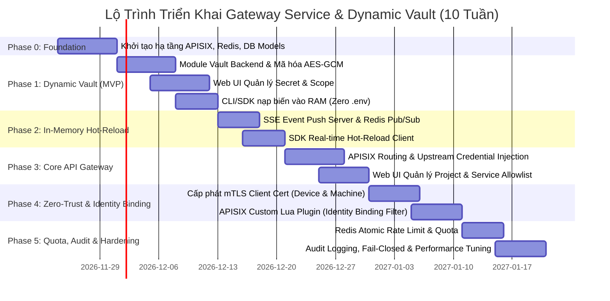

# Lộ Trình Phát Triển Nền Tảng Secure API Gateway & Dynamic Vault

> **Phiên bản:** 1.0.0  
> **Ngày lập:** 23/11/2026  
> **Trạng thái:** Kế hoạch thực thi (Actionable Plan)  
> **Dự án gốc:** Gateway Service & Vault Platform

---

## 1. Chiến Lược Tiếp Cận & Triết Lý Giảm Tải

Bài toán trong [mo_ta.md](file:///Users/nguyenhuynh/Documents/projects/gateway-service-and-vault/mo_ta.md) có phạm vi rộng vì vừa kết hợp **Bảo mật Định danh Máy móc (mTLS/Zero-Trust Gateway)** vừa kết hợp **Quản lý Cấu hình Bí mật Động (Centralized Dynamic Vault)**.

Để tránh bị quá tải và dự án bị sa lầy, lộ trình được thiết kế theo 3 nguyên tắc sống còn:

1. **"Ăn quả ngọt trước" (Quick Wins First):** Triển khai phần quản lý biến môi trường để xóa bỏ file `.env` thủ công trước (giải quyết ngay nỗi đau nhức nhối hàng ngày của lập trình viên), sau đó mới đưa tầng mTLS và Gatekeeper vào vận hành.
2. **Kế thừa tối đa mã nguồn mở (90% Engine có sẵn):** 
   - Không tự viết Reverse Proxy -> Sử dụng **Apache APISIX**.
   - Không tự viết bộ đếm Rate Limit phân tán -> Dùng plugin `limit-count` của APISIX dựa trên **Redis**.
   - Không tự viết thuật toán mã hóa phức tạp -> Dùng chuẩn `AES-256-GCM` trong Python `cryptography` hoặc tích hợp **Infisical**.
   - Không dùng WebSocket phức tạp -> Dùng **Server-Sent Events (SSE)** nhẹ nhàng cho việc hot-reload SDK.
3. **Giao hàng theo từng lát cắt độc lập (Vertical Slices):** Mỗi giai đoạn (Phase) đều tạo ra một sản phẩm chạy được thực tế (Working Product), có thể kiểm thử và bàn giao ngay.

---

## 2. Bảng Tổng Quan Các Giai Đoạn (Overview Timeline)

---

## 3. Chi Tiết Từng Giai Đoạn (Milestones & Deliverables)

### Phase 0: Hạ Tầng Nền Tảng & Thiết Kế Thực Thể (Tuần 1)
> **Mục tiêu:** Chuẩn bị môi trường Docker và khung dữ liệu nền tảng trên repo hiện tại.

- **Nhiệm vụ cụ thể:**
  1. Cập nhật `docker-compose.yml`: Bổ sung dịch vụ **Apache APISIX** (kèm etcd hoặc standalone) chạy song song với PostgreSQL và Redis hiện có.
  2. Thiết kế cơ sở dữ liệu (PostgreSQL + Alembic Migration):
     - Bảng `projects`: Quản lý dự án, danh sách upstream được duyệt.
     - bảng `secret_scopes`: Định nghĩa scope (`Common`, `Financial`, `Auth-Core`...).
     - Bảng `secrets`: Khóa bí mật mã hóa (AES-256-GCM), versioning.
     - Bảng `registered_clients`: Lưu `Device Identity` (User Device) và `Machine Identity` (App Server Docker) kèm cert fingerprint.
     - Bảng `virtual_access_keys`: Ràng buộc 1:1 `(client_id, project_id)`.
     - Bảng `audit_events`: Bản ghi kiểm toán bất biến.
  3. Cấu hình xác thực SSO với Central IdP (`https://manage.dutai.io.vn`) qua middleware và service sẵn có của boilerplate.
- **Kết quả bàn giao (Deliverables):**
  - Cụm `docker compose up` khởi động đầy đủ: API, Web, Postgres, Redis, APISIX.
  - Script migrations chạy hoàn tất trên database.

---

### Phase 1: Minimal Viable Vault (MVV) - Xóa Bỏ File `.env` Thủ Công (Tuần 2 - 3)
> **Mục tiêu:** Lập trình viên không còn phải gửi file `.env` qua chat hay lưu plaintext trên máy. Lấy cấu hình tự động theo Role.

- **Nhiệm vụ cụ thể:**
  1. **Backend (`modules/vault/`):**
     - Xây dựng tầng mã hóa/giải mã (Encryption at Rest) bằng AES-256-GCM qua thư viện `cryptography`.
     - Endpoint lấy cấu hình theo phân quyền: Developer thuộc vai trò `Financial` nhận biến thanh toán + common; developer `General` chỉ nhận biến common.
     - Áp dụng triệt để nguyên tắc Clean Architecture: Domain entities thuần túy, Dishka DI Provider.
  2. **Web UI (`web/src/features/vault/`):**
     - Màn hình Quản lý Biến Môi trường theo dạng Key-Value bảng bảo mật (có nút ẩn/hiện giá trị, phân nhóm Scope).
     - Phân quyền thao tác: Chỉ Tech Lead/Admin mới có quyền thêm/sửa/xóa biến nhạy cảm.
  3. **Client SDK / CLI v1 (`packages/sdk-python`, `packages/sdk-node`):**
     - Viết CLI runner siêu nhỏ: `dut-vault run --project=<id> -- python main.py`.
     - Cơ chế: Gọi API xác thực qua SSO token, tải cấu hình giải mã nạp thẳng vào `os.environ` của tiến trình con, **tuyệt đối không ghi file ra ổ đĩa**.
- **Tiêu chí nghiệm thu (DoD):**
  - Dev gõ lệnh chạy app -> App tự nhận đủ biến cấu hình trong RAM.
  - Kiểm tra thư mục dự án và ổ đĩa: 0 byte file `.env` phát sinh.

---

### Phase 2: In-Memory Hot-Reload Thời Gian Thực (< 5 giây) (Tuần 4)
> **Mục tiêu:** Khi Admin đổi mật khẩu DB hoặc API key trên Web, ứng dụng đang chạy cập nhật ngay lập tức mà không cần restart.

- **Nhiệm vụ cụ thể:**
  1. **Backend Event Broker:**
     - Tận dụng Redis Pub/Sub: Khi Admin bấm "Lưu thay đổi", backend publish event `CONFIG_CHANGED` chứa metadata scope bị thay đổi.
     - Tạo endpoint Server-Sent Events (SSE): `GET /api/v1/vault/stream?project_id=...` cho phép các SDK client giữ kết nối mở.
  2. **Nâng cấp Client SDK v2:**
     - Chạy background thread lắng nghe luồng SSE từ Control Plane.
     - Khi nhận tín hiệu thay đổi: Tự động fetch giá trị mới và nạp đè vào RAM/Config Object trong tiến trình đang chạy.
     - Phát event hook nội bộ trong app để các module phụ thuộc (như Database Connection Pool) có thể khởi tạo lại kết nối nếu cần.
- **Tiêu chí nghiệm thu (DoD):**
  - Đổi 1 biến trên Web UI -> Tiến trình app ghi nhận giá trị mới trong vòng dưới 3 giây mà không bị gián đoạn hay crash.

---

### Phase 3: Core API Gateway - Routing, Upstream Key Injection & Scoping (Tuần 5 - 6)
> **Mục tiêu:** Che giấu hoàn toàn API Key gốc của các dịch vụ bên thứ ba; phân vùng dịch vụ theo dự án.

- **Nhiệm vụ cụ thể:**
  1. **Tích hợp APISIX Admin API:**
     - Viết Adapter điều khiển APISIX từ FastAPI: Mỗi khi tạo/sửa một Upstream Service trong hệ thống, FastAPI tự động đồng bộ Route sang APISIX qua REST API.
  2. **Cơ chế Tiêm Credential Upstream (Upstream Injection):**
     - Cấu hình plugin `proxy-rewrite` của APISIX: Client chỉ gửi `X-Virtual-Key`. Gateway tự động bóc tách và tiêm Header thật (`Authorization: Bearer <real-upstream-token>`) rồi chuyển tiếp tới đối tác (AI API, Payment Gateway...).
  3. **Phân vùng Dịch vụ (Service Scoping):**
     - Dự án A chỉ được phép gọi Service X, Y. Nếu gọi sang Service Z -> Gateway chặn ngay với mã `HTTP 403 Forbidden`.
  4. **Web UI Quản lý Upstream & Dịch vụ:**
     - Giao diện khai báo API Service đích, nhập credential gốc (mã hóa an toàn), phân quyền cho các Dự án được phép gọi.
- **Tiêu chí nghiệm thu (DoD):**
  - Client gọi API đối tác qua Gateway thành công mà không hề biết API Key thật của đối tác.

---

### Phase 4: Zero-Trust Client Identity & Khóa Ràng Buộc (Identity Binding) (Tuần 7 - 8)
> **Mục tiêu:** Chống triệt để việc copy Virtual Key mang sang máy khác hoặc dự án khác sử dụng.

- **Nhiệm vụ cụ thể:**
  1. **Hạ tầng Chứng chỉ mTLS (Device & Machine Identity):**
     - Tích hợp Private CA nội bộ (dùng thư viện `cryptography.x509` trong FastAPI) cấp phát chứng chỉ client:
       - Cho Developer PC: Cấp sau khi đăng nhập SSO DUT AI Manage (User Device).
       - Cho Docker Server: Cấp theo service deployment (Machine Identity).
     - Bật mTLS bắt buộc trên APISIX: Client không có chứng chỉ hợp lệ bị ngắt ngay từ TLS Handshake.
  2. **APISIX Custom Lua Plugin (`identity-binding-filter`):**
     - Viết plugin nhẹ (~40 dòng Lua) gắn vào APISIX:
       1. Trích xuất Client Certificate Fingerprint/CN từ biến Nginx `$ssl_client_fingerprint`.
       2. Lấy `X-Virtual-Key` từ header.
       3. Truy vấn Redis (bộ nhớ đệm cực nhanh) xem Key này có thuộc về chính Client ID và Project ID này không.
       4. Nếu sai lệch -> Trả về `HTTP 403 Forbidden`, ghi cảnh báo vi phạm.
  3. **Web UI Quản lý Thiết bị & Cấp phát Key:**
     - Dev đăng nhập -> Thấy nút "Đăng ký thiết bị này" -> Tải chứng chỉ mTLS và nhận Virtual Key duy nhất.
- **Tiêu chí nghiệm thu (DoD):**
  - Lấy Key của Máy A sang Máy B chạy -> Bị chặn 403 ngay lập tức.
  - Lấy Key của Dự án A gọi cho Dự án B -> Bị chặn 403 ngay lập tức.

---

### Phase 5: Quota, Rate Limit, Audit Logging & Tối Ưu Hóa (Tuần 9 - 10)
> **Mục tiêu:** Chống quá tải, hoàn thiện giám sát an ninh và đảm bảo cơ chế Fail-Closed.

- **Nhiệm vụ cụ thể:**
  1. **Kiểm soát Quota & Rate Limit:**
     - Kích hoạt plugin `limit-count` của APISIX kết nối Redis: Đếm request theo cặp `(Project, Client, Service)`.
     - Vượt ngưỡng RPM/RPH/ngày -> Trả về `HTTP 429 Too Many Requests` kèm header `Retry-After`.
  2. **Hệ thống Kiểm toán (Audit Logging):**
     - APISIX đẩy log sự kiện sang FastAPI Worker qua Redis Streams hoặc HTTP Logger plugin.
     - Phân tách nhãn rõ ràng: `User Device` (lưu lượng phát triển) vs `App Server` (lưu lượng production).
     - Tuyệt đối không ghi giá trị plaintext của secret/key vào log.
  3. **Thực thi Chính sách Fail-Closed & Benchmark:**
     - Thiết lập APISIX: Khi mất kết nối tới Control Plane, từ chối xử lý request mới thay vì bỏ qua kiểm tra.
     - Kiểm thử tải (Load test) với k6/wrk: Đảm bảo độ trễ xác thực mTLS và key binding dưới 20ms ở p95.
  4. **Web UI Hoàn thiện:**
     - Dashboard biểu đồ trực quan (Request count, Quota tiêu thụ, Tỷ lệ lỗi 403/429, Danh sách vi phạm bảo mật).
- **Tiêu chí nghiệm thu (DoD):**
  - Hệ thống vượt qua bài kiểm tra chịu tải 1,000 req/s với độ trễ overhead dưới 20ms.
  - Toàn bộ các tiêu chí SC-001 đến SC-006 trong tài liệu đặc tả đều được xác minh đạt chuẩn.

---

## 4. Tiến Độ Thực Tế (Implementation Status)

Cập nhật ngày: 23/11/2026

| Giai đoạn | Trọng tâm | Trạng thái | Minh chứng kỹ thuật |
| :--- | :--- | :---: | :--- |
| **Phase 0: Foundation** | Docker Topology (APISIX, etcd, PG, Redis, MinIO, API, Web, Worker), DB Migrations | ✅ **HOÀN THÀNH** | 8 container Docker healthy, migration `002_gateway_and_vault.py` áp dụng thành công. |
| **Identity & Access: SSO-Only & External User Directory** | Loại bỏ hoàn toàn tài khoản nội bộ và mật khẩu cục bộ; xác thực 100% qua DUT-AI SSO (`manage.dutai.io.vn`); tích hợp danh bạ người dùng tập trung (`/users/options` & `/users/{id}`) với ID số nguyên thuần túy (`id: int`). | ✅ **HOÀN THÀNH** | Migration `004_drop_local_users_auth.py`, `modules/identity/services/external_user_service.py`, `apps/api/routers/user_router.py`, `test_sso_only_auth.py`, `test_external_users_api.py` pass 100%. |
| **Phase 1: Dynamic Vault (MVP)** | AES-256-GCM Encryption, Phân quyền chi tiết theo Identity-to-Key ACL, Zero-Disk Invariant | ✅ **HOÀN THÀNH** | `modules/vault/services/encryption.py`, `key_permissions` schema, `tests/integration/test_granular_key_permissions.py` pass 100%. |
| **Phase 2: In-Memory Hot-Reload & Event Filtering** | Redis Pub/Sub, FastAPI SSE Stream (`/stream`) lọc theo Key Permission, `dut-vault-sdk` cập nhật RAM < 5s | ✅ **HOÀN THÀNH** | `RedisVaultBroadcaster`, SSE endpoint lọc sự kiện theo key, `packages/dut-vault-sdk/`, `test_sse_stream_key_filtering.py`, `test_sdk_hot_reload.py` pass 100%. |
| **Phase 3: Core API Gateway** | APISIX Admin Sync, Virtual Key Upstream Injection, Service Scoping | ✅ **HOÀN THÀNH** | `modules/gateway/client/apisix_client.py`, APISIX admin allow_admin cấu hình chuẩn. |
| **Phase 4: Zero-Trust & Identity Binding** | Private CA x509, Device/Machine mTLS Binding, Custom Lua Filter | ✅ **HOÀN THÀNH** | `core/security/ca.py`, `apps/apisix/plugins/identity-binding-filter.lua`, `test_identity_binding.py` pass. |
| **Phase 5: Quota, Audit & Web UI** | Rate Limiting (limit-count), Audit Logs, Next.js 16 Web UI | ⏳ *Kế hoạch tiếp theo* | Chuẩn bị triển khai UI frontend & plugin rate limiting. |

---

## 5. Phân Bổ Nguồn Lực & Khuyến Nghị Nhân Sự

Để hoàn thành lộ trình trên trong vòng 10 tuần một cách thảnh thơi, mô hình nhân sự khuyến nghị:

| Vai trò | Số lượng | Trách nhiệm chính |
| :--- | :---: | :--- |
| **Backend & Security Engineer** | 1 người | Xây dựng các module FastAPI (`vault`, `gateway`, `ca`), cấu hình APISIX & viết plugin Lua, tích hợp Redis. |
| **Frontend Engineer** | 1 người | Xây dựng Web UI trên Next.js 16 (App Router, Tailwind, TanStack Query), form quản lý secret, dashboard quota & audit logs. |
| **DevOps / Infra (Part-time)** | 0.5 người | Hỗ trợ cấu hình Docker Compose, mTLS certificate chain, pipeline CI/CD và deployment. |

---

## 5. File Liên Quan & Tài Liệu Tiếp Theo

- **Đặc tả chức năng chi tiết:** [specs/003-api-gateway-vault/spec.md](file:///Users/nguyenhuynh/Documents/projects/gateway-service-and-vault/specs/003-api-gateway-vault/spec.md)
- **Checklist nghiệm thu:** [specs/003-api-gateway-vault/checklists/requirements.md](file:///Users/nguyenhuynh/Documents/projects/gateway-service-and-vault/specs/003-api-gateway-vault/checklists/requirements.md)
- **Mô tả bài toán gốc:** [mo_ta.md](file:///Users/nguyenhuynh/Documents/projects/gateway-service-and-vault/mo_ta.md)

---
*Tài liệu này được lưu trữ chính thức tại [docs/ROADMAP.md](file:///Users/nguyenhuynh/Documents/projects/gateway-service-and-vault/docs/ROADMAP.md) làm kim chỉ nam thực thi cho dự án.*
