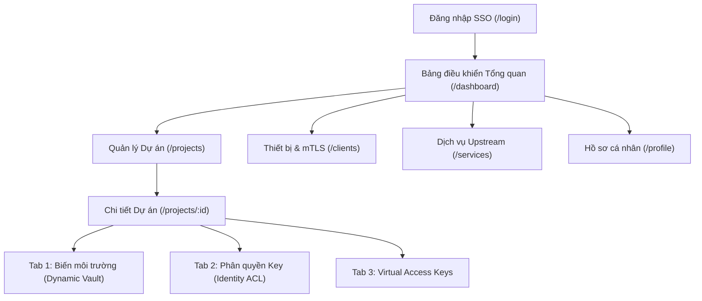

# Lộ Trình Phát Triển Giao Diện Web: Secure API Gateway & Dynamic Vault

> **Phiên bản:** 1.0.0  
> **Ngày lập:** 23/11/2026  
> **Trạng thái:** Kế hoạch thực thi chính thức (Frontend Roadmap)  
> **Dự án:** Gateway Service & Vault Platform  
> **Công nghệ:** Next.js 16 (App Router), React 19, Tailwind CSS v4, TanStack Query v5, Radix UI / Lucide, TypeScript (Strict).

---

## 1. Triết Lý & Nguyên Tắc Thiết Kế Giao Diện

Giao diện Web đóng vai trò là **Bảng điều khiển Trung tâm (Control Plane Web UI)** cho cả hai đối tượng:
- **Developer / Team Member:** Xem dự án được phân quyền, quản lý biến môi trường trong RAM (Zero `.env`), đăng ký máy tính cá nhân để lấy chứng chỉ mTLS và Virtual Key.
- **Tech Lead / DevOps / Security Admin:** Quản lý dự án, gom nhóm Scope biến môi trường, phân quyền chi tiết cho từng Key (`key_permissions`), quản lý danh sách thiết bị mTLS, cấu hình Upstream Services và giám sát luồng hot-reload SSE thời gian thực.

### 4 Nguyên Tắc Cốt Lõi:
1. **100% Type-Safe qua OpenAPI Contract:** Mọi request/response trên giao diện bắt buộc dùng kiểu dữ liệu được tự động sinh tại [api.generated.d.ts](file:///Users/nguyenhuynh/Documents/projects/gateway-service-and-vault/web/src/types/api.generated.d.ts) (đồng bộ qua `make api-types`). Không tự viết interface thủ công.
2. **Bảo mật Tối đa (Zero Credential Leakage):** Giá trị secret nhạy cảm mặc định bị che (dấu sao `••••••••`), chỉ hiển thị khi người dùng bấm "Xem" và có audit action; credential upstream gốc không bao giờ trả về plaintext cho client thông thường.
3. **Phản hồi Thời gian thực (Real-Time Feedback):** Tích hợp Server-Sent Events (SSE) để hiển thị ngay lập tức trạng thái đồng bộ khi biến môi trường thay đổi mà không cần người dùng F5 tải lại trang.
4. **Kiến trúc Feature-Driven (Modular Frontend):** Phân chia mã nguồn rõ ràng theo module tính năng (`web/src/features/*`), tách biệt Hook truy vấn (TanStack Query), DTO Types và Component giao diện.

---

## 2. Bản Đồ Điều Hướng & Cấu Trúc URL (Sitemap)



---

## 3. Lộ Trình 5 Giai Đoạn Triển Khai (Milestones)

### Giai Đoạn 1: Cấu Trúc Khung & Quản Lý Dự Án (Project Hub)
> **Mục tiêu:** Hoàn thiện App Shell (Sidebar, Header, Breadcrumbs), tích hợp SSO profile và màn hình quản lý danh sách/chi tiết dự án.

- **Nhiệm vụ cụ thể:**
  1. **Nâng cấp Navigation ([app-shell.tsx](file:///Users/nguyenhuynh/Documents/projects/gateway-service-and-vault/web/src/components/layout/app-shell.tsx)):**
     - Bổ sung menu: Dashboard (`/dashboard`), Dự án (`/projects`), Thiết bị mTLS (`/clients`), Dịch vụ Upstream (`/services`).
     - Hiển thị thông tin người dùng SSO (Avatar, Họ tên, Role badge `Admin`/`Member`).
  2. **Feature Projects (`web/src/features/projects/`):**
     - Hook API: `useProjectsQuery()` (`GET /api/v1/gateway/projects`), `useCreateProjectMutation()` (`POST /api/v1/gateway/projects`), `useProjectDetailQuery(id)` (`GET /api/v1/gateway/projects/{id}`).
     - Component:
       - `ProjectList`: Danh sách dạng lưới/thẻ (Card Grid) kèm số liệu thống kê.
       - `CreateProjectDialog`: Modal tạo dự án với validation Zod (`name`, `slug`, `description`).
       - `ProjectHeader`: Header chi tiết dự án kèm tab chuyển đổi nhanh (Vault, Virtual Keys, Settings).
- **Tiêu chí nghiệm thu (DoD):**
  - Đăng nhập SSO thành công -> Vào Dashboard thấy danh sách dự án.
  - Bấm "Tạo dự án mới" -> Dự án xuất hiện ngay lập tức trên danh sách.

---

### Giai Đoạn 2: Quản Lý Dynamic Vault & Phân Quyền Từng Key (Vault & ACL)
> **Mục tiêu:** Xóa bỏ file `.env` thủ công. Xây dựng bảng quản lý secret phân nhóm theo Scope và modal phân quyền ai được đọc key gì.

- **Nhiệm vụ cụ thể:**
  1. **Feature Vault (`web/src/features/vault/`):**
     - Hook API:
       - `useScopesQuery(projectId)` (`GET /api/v1/vault/projects/{id}/scopes`).
       - `useSecretsQuery(projectId, scope, key)` (`GET /api/v1/vault/projects/{id}/secrets`).
       - `useSaveSecretMutation(projectId)` (`POST /api/v1/vault/projects/{id}/secrets`).
     - Component:
       - `ScopeTabs`: Thanh chuyển đổi giữa các nhóm cấu hình (`Common`, `Database`, `Payment`,...).
       - `SecretsTable`: Bảng Key - Value an toàn:
         - Nút ẩn/hiện giá trị (`Eye`/`EyeOff`).
         - Nút Copy giá trị vào clipboard.
         - Nút "Thêm biến mới" và "Sửa biến".
         - Input dạng mono-font (`font-mono`) cho key và value.
  2. **Feature Key Permissions (`web/src/features/vault/permissions/`):**
     - Hook API:
       - `useUserOptionsQuery()` (`GET /api/v1/users/options` từ danh bạ trung tâm).
       - `useIdentityPermissionsQuery(projectId, identityId)` (`GET /api/v1/vault/projects/{id}/permissions`).
       - `useGrantPermissionMutation(projectId)` (`POST /api/v1/vault/projects/{id}/permissions`).
       - `useRevokePermissionMutation(projectId)` (`DELETE /api/v1/vault/projects/{id}/permissions`).
     - Component:
       - `KeyPermissionMatrixModal`: Modal gán quyền truy cập:
         - Dropdown chọn User/Client từ danh bạ DUT-AI Manage.
         - Danh sách checkbox các Key bí mật trong dự án: Đánh dấu key nào thì cấp quyền key đó.
         - Nút "Lưu quyền" -> Cập nhật trực tiếp xuống bảng `key_permissions`.
- **Tiêu chí nghiệm thu (DoD):**
  - Thêm 1 biến môi trường mới -> Giá trị được mã hóa AES-256-GCM tại backend.
  - Phân quyền User A chỉ đọc `DB_HOST`, User B đọc cả `DB_HOST` và `STRIPE_KEY` -> Kiểm tra giao diện hiển thị đúng biến theo quyền.

---

### Giai Đoạn 3: Real-Time In-Memory Hot-Reload Stream (SSE Live Sync)
> **Mục tiêu:** Giám sát thời gian thực việc nạp biến môi trường; ứng dụng nhận thay đổi cấu hình dưới 5 giây không cần restart.

- **Nhiệm vụ cụ thể:**
  1. **Hook SSE Client (`web/src/features/vault/hooks/use-vault-sse.ts`):**
     - Mở kết nối `EventSource` tới `GET /api/v1/vault/projects/{id}/stream`.
     - Tự động bắt sự kiện `secret_update` và `ping` heartbeat.
     - Tự động reconnect với exponential backoff khi rớt mạng.
  2. **Component Trạng thái Đồng bộ Live:**
     - `LiveSyncStatusBadge`: Đèn tín hiệu xanh (Live Connected), vàng (Reconnecting), xám (Disconnected).
     - `LiveAuditFeed`: Danh sách thông báo trực tiếp: *"Admin vừa cập nhật biến OPENAI_API_KEY (Scope: Common) lúc 10:45:02"*.
     - Tự động invalidate TanStack Query cache khi có sự kiện thay đổi để UI tự làm mới số liệu mà không cần F5.
- **Tiêu chí nghiệm thu (DoD):**
  - Mở 2 tab trình duyệt: Tab 1 sửa giá trị biến -> Tab 2 nhảy thông báo cập nhật và tự đổi giá trị trong vòng < 3 giây.

---

### Giai Đoạn 4: Quản Lý Thiết Bị mTLS & Cấp Phát Virtual Keys (Zero-Trust Gatekeeper) - [x] Đã hoàn thành
> **Mục tiêu:** Cấp phát chứng chỉ mTLS cho Developer PC và Docker Server; sinh Virtual Access Key ràng buộc 1:1 chống rò rỉ. *(Đã hoàn thành trong nhánh `010-web-mtls-virtual-keys`)*

- **Nhiệm vụ cụ thể:**
  1. **Feature Clients (`web/src/features/clients/`):**
     - Hook API:
       - `useClientsQuery()` (`GET /api/v1/gateway/clients`).
       - `useRegisterClientMutation()` (`POST /api/v1/gateway/clients`).
     - Component:
       - `ClientsTable`: Bảng danh sách thiết bị/máy chủ đã cấp chứng chỉ (Tên, Loại `USER_DEVICE`/`APP_SERVER`, Fingerprint SHA-256, Hạn dùng).
       - `RegisterClientDialog`: Form đăng ký thiết bị:
         - Nhập tên máy (ví dụ: `MacBook Pro M3 - Nguyen`).
         - Chọn loại máy (Developer PC hoặc Server).
         - Chọn thời hạn chứng chỉ (30 ngày, 90 ngày, 365 ngày).
         - Sau khi tạo thành công: Hiển thị hộp thoại tải về 2 file `client.crt` và `client.key` (chỉ hiển thị 1 lần duy nhất).
  2. **Feature Virtual Keys (`web/src/features/keys/`):**
     - Hook API:
       - `useProjectKeysQuery(projectId)` (`GET /api/v1/gateway/projects/{id}/keys`).
       - `useGenerateKeyMutation()` (`POST /api/v1/gateway/keys`).
       - `useRevokeKeyMutation()` (`POST /api/v1/gateway/keys/{id}/revoke`).
     - Component:
       - `VirtualKeysTable`: Bảng danh sách khóa ảo (Tiền tố `vkey_dev_...`, Thiết bị sở hữu, Trạng thái `ACTIVE`/`REVOKED`).
       - `GenerateKeyModal`: Chọn thiết bị -> Bấm tạo khóa -> Nhận Virtual Key hoàn chỉnh kèm câu lệnh mẫu chạy CLI:
         `dut-vault run --key=vkey_... -- python main.py`
       - Action: Nút "Thu hồi khóa" (Revoke) có cảnh báo xác nhận.
- **Tiêu chí nghiệm thu (DoD):**
  - Đăng ký thiết bị -> Tải được file chứng chỉ mTLS về máy.
  - Cấp Virtual Key cho thiết bị đó -> Khóa hiển thị ở trạng thái `ACTIVE`.
  - Bấm thu hồi -> Khóa chuyển ngay sang `REVOKED`.

---

### Giai Đoạn 5: Quản Lý Upstream Services & Hoàn Thiện Trải Nghiệm (Polish & DoD) - [x] Đã hoàn thành
> **Mục tiêu:** Quản lý dịch vụ đối tác (OpenAI, Payment API,...) được Gateway bảo vệ, hoàn thiện giao diện tổng thể và kiểm thử đầu-cuối. *(Đã hoàn thành trong nhánh `011-web-upstream-services`)*

- **Nhiệm vụ cụ thể:**
  1. **Feature Services (`web/src/features/services/`):**
     - Hook API:
       - `useServicesQuery()` (`GET /api/v1/gateway/services`).
       - `useCreateServiceMutation()` (`POST /api/v1/gateway/services`).
     - Component:
       - `ServicesTable`: Bảng danh sách dịch vụ (Tên, Slug, Base URL, Auth Type, Timeout).
       - `CreateServiceDialog`: Khai báo dịch vụ mới kèm nhập Token/Credential gốc của đối tác (mã hóa tại backend).
  2. **UI Polish & Quality Gates:**
     - Thiết kế giao diện theo phong cách chuyên nghiệp, sạch sẽ (Clean, Modern SaaS Dashboard).
     - Hỗ trợ trạng thái rỗng (Empty State), Skeleton Loading cho tất cả các bảng dữ liệu.
     - Thông báo Toast (thành công, lỗi, cảnh báo) qua thư viện Toast nhẹ.
     - Kiểm tra toàn diện trên trình duyệt: `pnpm typecheck` và `pnpm build` không có cảnh báo hoặc lỗi.
- **Tiêu chí nghiệm thu (DoD):**
  - Khai báo 1 Upstream Service -> Hiển thị trên bảng và sẵn sàng cho cấu hình Gateway.
  - Toàn bộ luồng nghiệp vụ từ Đăng nhập -> Tạo Dự án -> Nạp Secret -> Cấp Cert/Key hoạt động mượt mà.

---

## 4. Bảng Ánh Xạ Endpoint Backend & Màn Hình Giao Diện

| URL Giao diện (Route) | Mục đích Màn hình | Backend API tương ứng |
| :--- | :--- | :--- |
| `/login` | Đăng nhập tài khoản DUT-AI SSO | `POST /api/v1/auth/sso-login` |
| Bất kỳ màn hình nào | Lấy thông tin user hiện tại & avatar | `GET /api/v1/auth/me` |
| `/dashboard` | Thống kê số lượng dự án, thiết bị, keys | `GET /api/v1/gateway/projects`, `/clients` |
| `/projects` | Danh sách dự án & nút tạo mới | `GET /api/v1/gateway/projects`, `POST /api/v1/gateway/projects` |
| `/projects/[id]` | Chi tiết dự án, danh sách biến (Vault) | `GET /api/v1/gateway/projects/{id}`, `GET /api/v1/vault/projects/{id}/secrets` |
| `/projects/[id]` (Tab Vault) | Quản lý nhóm cấu hình (Scopes) | `GET /api/v1/vault/projects/{id}/scopes` |
| `/projects/[id]` (Tab Vault) | Thêm / Sửa giá trị biến môi trường | `POST /api/v1/vault/projects/{id}/secrets` |
| Modal Phân quyền Key | Lấy danh bạ người dùng cho dropdown | `GET /api/v1/users/options` |
| Modal Phân quyền Key | Xem các key một user được truy cập | `GET /api/v1/vault/projects/{id}/permissions?identity_id=...` |
| Modal Phân quyền Key | Cấp / Thu hồi quyền đọc từng key | `POST /api/v1/vault/projects/{id}/permissions`, `DELETE ...` |
| Banner Header Dự án | Lắng nghe thay đổi biến thời gian thực | `GET /api/v1/vault/projects/{id}/stream` (SSE) |
| `/clients` | Danh sách thiết bị & đăng ký cấp cert | `GET /api/v1/gateway/clients`, `POST /api/v1/gateway/clients` |
| `/projects/[id]` (Tab Keys) | Danh sách Virtual Keys của dự án | `GET /api/v1/gateway/projects/{id}/keys` |
| `/projects/[id]` (Tab Keys) | Cấp mới Virtual Key | `POST /api/v1/gateway/keys` |
| `/projects/[id]` (Tab Keys) | Thu hồi Virtual Key | `POST /api/v1/gateway/keys/{id}/revoke` |
| `/services` | Quản lý Upstream Services đích | `GET /api/v1/gateway/services`, `POST /api/v1/gateway/services` |

---

## 5. Tổ Chức Thư Mục Mã Nguồn Đề Xuất Cho Frontend

```text
web/src/
├── app/
│   ├── (auth)/
│   │   └── login/page.tsx               # Trang đăng nhập SSO
│   ├── (protected)/
│   │   ├── layout.tsx                   # AppShell Layout chung
│   │   ├── dashboard/page.tsx           # Bảng điều khiển tổng quan
│   │   ├── projects/
│   │   │   ├── page.tsx                 # Danh sách dự án
│   │   │   └── [id]/page.tsx            # Chi tiết dự án (Vault, Keys, Settings)
│   │   ├── clients/page.tsx             # Quản lý thiết bị mTLS
│   │   └── services/page.tsx            # Quản lý Upstream Services
│   └── layout.tsx
├── components/
│   ├── layout/                          # AppShell, Sidebar, Header
│   └── ui/                              # Button, Input, Dialog, Table, Badge, Dropdown
├── features/
│   ├── auth/                            # Logic đăng nhập, session, token
│   ├── projects/                        # ProjectList, CreateProjectModal, hooks
│   ├── vault/                           # SecretsTable, ScopeTabs, AddSecretModal
│   │   ├── permissions/                 # KeyPermissionMatrixModal, hooks
│   │   └── hooks/use-vault-sse.ts       # SSE Stream hook
│   ├── clients/                         # ClientsTable, RegisterClientModal
│   ├── keys/                            # VirtualKeysTable, GenerateKeyModal
│   └── services/                        # ServicesTable, CreateServiceModal
├── lib/
│   ├── api.ts                           # Axios client có interceptor
│   └── auth-token.ts                    # Quản lý access_token
└── types/
    └── api.generated.d.ts               # Định nghĩa kiểu tự động từ backend
```

---

## 6. Kế Hoạch Thực Hiện Khuyến Nghị

- **Bước 1 (Ưu tiên cao nhất):** Xây dựng **Giai đoạn 1 (Project Hub)** và **Giai đoạn 2 (Dynamic Vault & Key Permissions)**. Hoàn thành 2 giai đoạn này sẽ giải quyết ngay bài toán cốt lõi: loại bỏ file `.env` và quản lý phân quyền biến môi trường.
- **Bước 2:** Bổ sung **Giai đoạn 4 (Clients & Virtual Keys)** để hoàn thiện quy trình bảo mật Zero-Trust cho lập trình viên.
- **Bước 3:** Tích hợp **Giai đoạn 3 (SSE Hot-reload)** và **Giai đoạn 5 (Services)** để nâng tầm sản phẩm hoàn chỉnh như một Cloud Control Plane chuyên nghiệp.

---

## 7. Trạng Thái Hoàn Thành Toàn Bộ Lộ Trình (Definition of Done)

- [x] **Giai đoạn 1**: Project Hub & Core Navigation (`specs/007-web-project-hub/`)
- [x] **Giai đoạn 2**: Dynamic Vault & Key-Level ACL (`specs/008-web-vault-acl/`)
- [x] **Giai đoạn 3**: Real-Time In-Memory Hot-Reload Stream SSE (`specs/009-web-vault-sse-sync/`)
- [x] **Giai đoạn 4**: Quản lý thiết bị mTLS & Cấp phát Virtual Keys (`specs/010-web-mtls-virtual-keys/`)
- [x] **Giai đoạn 5**: Quản lý Upstream Services & Hoàn thiện trải nghiệm (`specs/011-web-upstream-services/`)

