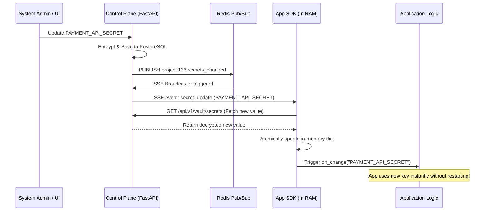

# In-Memory Client SDK Contract (`dut-vault-sdk`)

This document defines the runtime interaction model and behavioral contract for the **In-Memory Client SDK** (`dut-vault-sdk`).

---

## 1. Zero-Disk-Artifact Invariant

The SDK operates under a strict security constraint:
> **INVARIANT**: Under NO circumstances will the SDK write plaintext secrets, temporary files, `.env` files, or cached credential dumps to disk, temp directories, or persistent logs.

All decrypted configurations must reside solely within process RAM.

---

## 2. SDK Usage Patterns

### Pattern A: CLI Process Runner (Drop-in for any command)

Developers or Docker startup scripts prefix their execution with `dut-vault run`:

```bash
# Developer local environment (after SSO login)
dut-vault run --project=my-billing-app -- python -m apps.api.main

# Docker container environment
dut-vault run --project=my-billing-app --client-cert=/etc/certs/client.pem -- node dist/index.js
```

**Lifecycle**:
1. SDK authenticates with the Control Plane (`/api/v1/vault/projects/{id}/secrets`).
2. Fetches and decrypts authorized secrets for the user's role / client identity into a memory dictionary.
3. Injects the key-value pairs directly into the child process's environment block (`execve(..., envp)`).
4. Spawns a background thread listening to the SSE stream (`/api/v1/vault/projects/{id}/stream`).
5. Child process runs with access to variables via `process.env` (Node.js) or `os.environ` (Python).

---

### Pattern B: Native Python Library (Dynamic Hot-Reload)

For applications needing live variable updates without restarting:

```python
from dut_vault_sdk import VaultConfig

# Initialize singleton config
config = VaultConfig(project_id="proj_01JABC...", enable_hot_reload=True)

# Access variables
db_url = config.get("DATABASE_URL")
payment_key = config.get("PAYMENT_API_SECRET")

# Register hot-reload callback if needed (e.g. rotate connection pool)
@config.on_change("PAYMENT_API_SECRET")
def on_payment_key_rotated(new_key: str):
    payment_client.rotate_credentials(new_key)
```

**Hot-Reload Sequence**:

