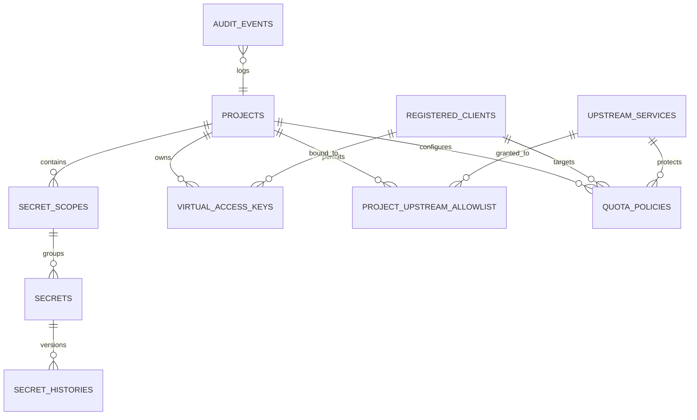

# Data Model & Entity Specifications: Gateway Service & Dynamic Vault

This document defines the domain entities, database persistence models, and DTO schemas across the **Gateway** and **Vault** bounded contexts, adhering strictly to the **Clean Architecture & Domain Purity Invariant** (Constitutional Principle I).

---

## 1. Domain Entities (`modules/*/domain/entities.py`)

Domain entities are pure Python dataclasses with **ZERO framework dependencies** (`pydantic`, `fastapi`, `sqlalchemy`).

### 1.1. Gateway Domain Entities (`modules/gateway/domain/entities.py`)

```python
from dataclasses import dataclass, field
from datetime import datetime
from enum import Enum
from typing import Optional


class ClientType(str, Enum):
    USER_DEVICE = "USER_DEVICE"
    APP_SERVER = "APP_SERVER"


class KeyStatus(str, Enum):
    ACTIVE = "ACTIVE"
    REVOKED = "REVOKED"
    EXPIRED = "EXPIRED"


@dataclass
class Project:
    id: str
    name: str
    slug: str
    description: Optional[str] = None
    created_at: datetime = field(default_factory=datetime.utcnow)
    updated_at: datetime = field(default_factory=datetime.utcnow)


@dataclass
class UpstreamService:
    id: str
    name: str
    slug: str
    base_url: str
    auth_type: str  # BEARER_TOKEN, API_KEY, BASIC
    encrypted_credential: str
    timeout_seconds: int = 30
    is_active: bool = True
    created_at: datetime = field(default_factory=datetime.utcnow)


@dataclass
class RegisteredClient:
    id: str
    client_type: ClientType
    name: str
    owner_id: str  # User ID from DUT AI SSO or Application Service Name
    cert_fingerprint: str  # SHA-256 fingerprint of the client x509 cert
    cert_serial: str
    expires_at: datetime
    is_revoked: bool = False
    created_at: datetime = field(default_factory=datetime.utcnow)


@dataclass
class VirtualAccessKey:
    id: str
    key_hash: str  # SHA-256 of the virtual key
    key_prefix: str  # First 8 chars for identification (e.g. vk_live_ab12...)
    client_id: str
    project_id: str
    status: KeyStatus = KeyStatus.ACTIVE
    last_used_at: Optional[datetime] = None
    created_at: datetime = field(default_factory=datetime.utcnow)
    revoked_at: Optional[datetime] = None


@dataclass
class QuotaPolicy:
    id: str
    project_id: str
    client_id: Optional[str]  # None = applies to all clients of the project
    service_id: str
    rate_limit_rpm: int = 60  # Requests per minute
    quota_daily: int = 10000  # Requests per day
    is_active: bool = True


@dataclass
class AuditEvent:
    id: str
    timestamp: datetime
    client_type: ClientType
    actor_id: str
    project_id: str
    service_id: Optional[str]
    action: str  # API_CALL, SECRET_READ, KEY_GENERATED, IDENTITY_MISMATCH
    decision: str  # ALLOW, DENY
    client_ip: Optional[str]
    error_code: Optional[str]
    metadata: dict = field(default_factory=dict)
```

---

### 1.2. Vault Domain Entities (`modules/vault/domain/entities.py`)

```python
from dataclasses import dataclass, field
from datetime import datetime
from typing import Optional


@dataclass
class SecretScope:
    id: str
    project_id: str
    name: str  # e.g., Common, Financial, Auth-Core
    description: Optional[str] = None
    created_at: datetime = field(default_factory=datetime.utcnow)


@dataclass
class SecretItem:
    id: str
    project_id: str
    scope_id: str
    key: str
    encrypted_value: str
    nonce: str
    auth_tag: str
    version: int = 1
    created_by: str = ""
    updated_by: str = ""
    created_at: datetime = field(default_factory=datetime.utcnow)
    updated_at: datetime = field(default_factory=datetime.utcnow)


@dataclass
class SecretHistory:
    id: str
    secret_id: str
    version: int
    encrypted_value: str
    nonce: str
    auth_tag: str
    modified_by: str
    created_at: datetime = field(default_factory=datetime.utcnow)
```

---

## 2. Persistence Schema (SQLAlchemy ORM Models)

### Tables in PostgreSQL



### Table Definitions:

1. **`projects`**:
   - `id`: VARCHAR(32) PRIMARY KEY (ULID)
   - `name`: VARCHAR(100) NOT NULL
   - `slug`: VARCHAR(100) UNIQUE NOT NULL
   - `description`: TEXT
   - `created_at`, `updated_at`: TIMESTAMPTZ

2. **`upstream_services`**:
   - `id`: VARCHAR(32) PRIMARY KEY (ULID)
   - `name`: VARCHAR(100) NOT NULL
   - `slug`: VARCHAR(100) UNIQUE NOT NULL
   - `base_url`: VARCHAR(255) NOT NULL
   - `auth_type`: VARCHAR(30) NOT NULL (`BEARER_TOKEN`, `API_KEY`, `BASIC`)
   - `encrypted_credential`: TEXT NOT NULL
   - `timeout_seconds`: INTEGER DEFAULT 30
   - `is_active`: BOOLEAN DEFAULT TRUE

3. **`project_upstream_allowlist`**:
   - `project_id`: VARCHAR(32) REFERENCES `projects(id)` ON DELETE CASCADE
   - `service_id`: VARCHAR(32) REFERENCES `upstream_services(id)` ON DELETE CASCADE
   - PRIMARY KEY (`project_id`, `service_id`)

4. **`registered_clients`**:
   - `id`: VARCHAR(32) PRIMARY KEY (ULID)
   - `client_type`: VARCHAR(20) NOT NULL (`USER_DEVICE`, `APP_SERVER`)
   - `name`: VARCHAR(100) NOT NULL
   - `owner_id`: VARCHAR(100) NOT NULL
   - `cert_fingerprint`: VARCHAR(64) UNIQUE NOT NULL (SHA-256)
   - `cert_serial`: VARCHAR(64) NOT NULL
   - `expires_at`: TIMESTAMPTZ NOT NULL
   - `is_revoked`: BOOLEAN DEFAULT FALSE
   - `created_at`: TIMESTAMPTZ NOT NULL

5. **`virtual_access_keys`**:
   - `id`: VARCHAR(32) PRIMARY KEY (ULID)
   - `key_hash`: VARCHAR(64) UNIQUE NOT NULL (SHA-256)
   - `key_prefix`: VARCHAR(16) NOT NULL
   - `client_id`: VARCHAR(32) REFERENCES `registered_clients(id)` ON DELETE CASCADE
   - `project_id`: VARCHAR(32) REFERENCES `projects(id)` ON DELETE CASCADE
   - `status`: VARCHAR(20) DEFAULT 'ACTIVE'
   - `last_used_at`: TIMESTAMPTZ
   - `created_at`, `revoked_at`: TIMESTAMPTZ
   - *Constraint*: Unique active key per `(client_id, project_id)`.

6. **`secret_scopes`**:
   - `id`: VARCHAR(32) PRIMARY KEY (ULID)
   - `project_id`: VARCHAR(32) REFERENCES `projects(id)` ON DELETE CASCADE
   - `name`: VARCHAR(50) NOT NULL
   - `description`: VARCHAR(255)
   - UNIQUE (`project_id`, `name`)

7. **`secrets`**:
   - `id`: VARCHAR(32) PRIMARY KEY (ULID)
   - `project_id`: VARCHAR(32) REFERENCES `projects(id)` ON DELETE CASCADE
   - `scope_id`: VARCHAR(32) REFERENCES `secret_scopes(id)` ON DELETE CASCADE
   - `key`: VARCHAR(100) NOT NULL
   - `encrypted_value`: TEXT NOT NULL
   - `nonce`: VARCHAR(32) NOT NULL
   - `auth_tag`: VARCHAR(32) NOT NULL
   - `version`: INTEGER DEFAULT 1
   - `created_by`, `updated_by`: VARCHAR(100)
   - `created_at`, `updated_at`: TIMESTAMPTZ
   - UNIQUE (`scope_id`, `key`)

8. **`audit_events`**:
   - `id`: VARCHAR(32) PRIMARY KEY (ULID)
   - `timestamp`: TIMESTAMPTZ NOT NULL
   - `client_type`: VARCHAR(20) NOT NULL
   - `actor_id`: VARCHAR(100) NOT NULL
   - `project_id`: VARCHAR(32) NOT NULL
   - `service_id`: VARCHAR(32)
   - `action`: VARCHAR(50) NOT NULL
   - `decision`: VARCHAR(10) NOT NULL (`ALLOW`, `DENY`)
   - `client_ip`: VARCHAR(45)
   - `error_code`: VARCHAR(50)
   - `metadata`: JSONB DEFAULT '{}'::jsonb

---

## 3. Data Transfer Objects (DTOs)

### Gateway DTOs (`modules/gateway/dtos/`)
- `ProjectCreateDTO`: `{ name: str, slug: str, description: Optional[str] }`
- `ProjectResponseDTO`: `{ id: str, name: str, slug: str, description: Optional[str], created_at: datetime }`
- `RegisterClientDTO`: `{ client_type: ClientType, name: str, csr_pem: Optional[str] }`
- `RegisteredClientResponseDTO`: `{ id: str, client_type: ClientType, name: str, cert_fingerprint: str, expires_at: datetime }`
- `VirtualKeyCreateDTO`: `{ client_id: str, project_id: str }`
- `VirtualKeyResponseDTO`: `{ id: str, virtual_key: str, key_prefix: str, client_id: str, project_id: str, status: str }`

### Vault DTOs (`modules/vault/dtos/`)
- `SecretCreateDTO`: `{ project_id: str, scope_name: str, key: str, value: str }`
- `SecretBatchResponseDTO`: `{ project_id: str, scope_name: str, secrets: dict[str, str], version: int }`
- `SecretUpdateEventDTO`: `{ project_id: str, scope_name: str, changed_keys: list[str], timestamp: datetime }`
