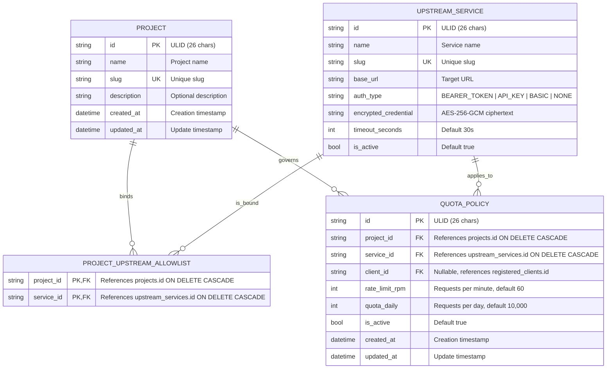

# Data Model: Project Upstream Service Binding & Quota Governance

**Feature Branch**: `012-project-service-binding`
**Created**: 2026-11-23

## Entity Relationship Overview

## Domain Data Transfer Objects (DTOs)

### 1. `ProjectAllowedServiceDTO` (Response DTO)
Represents a bound upstream service including its active quota policy.
- `service_id`: `str`
- `service_name`: `str`
- `service_slug`: `str`
- `base_url`: `str`
- `auth_type`: `str`
- `is_service_active`: `bool`
- `rate_limit_rpm`: `int` (requests per minute)
- `quota_daily`: `int` (requests per day)
- `is_quota_active`: `bool`
- `bound_at`: `datetime`

### 2. `BindServiceToProjectRequest` (Request DTO)
Payload sent by frontend to authorize an upstream service for a project.
- `service_id`: `str` (ULID of upstream service, min_length=26, max_length=26)
- `rate_limit_rpm`: `int` (>= 1, default 60)
- `quota_daily`: `int` (>= 1, default 10,000)

### 3. `UpdateServiceQuotaRequest` (Request DTO)
Payload sent to adjust quota limits for an already bound service.
- `rate_limit_rpm`: `int` (>= 1)
- `quota_daily`: `int` (>= 1)

## Invariants & Validation Rules

1. **Uniqueness**: A service can only be bound to a project once. Primary key `(project_id, service_id)` on `project_upstream_allowlist` guarantees relational uniqueness.
2. **Quota Bounds**:
   - `rate_limit_rpm` must be an integer between 1 and 100,000.
   - `quota_daily` must be an integer between 1 and 10,000,000.
3. **Cascading Cleanliness**:
   - Deleting a project automatically deletes its allowlist entries and quota policies.
   - Deleting an upstream service automatically cleans up all associated project allowlists and quota policies.
4. **Zero-Trust Default**: If a project has no record in `project_upstream_allowlist` for a given `service_id`, any API gateway call to that service is denied with `HTTP 403 Forbidden`.
