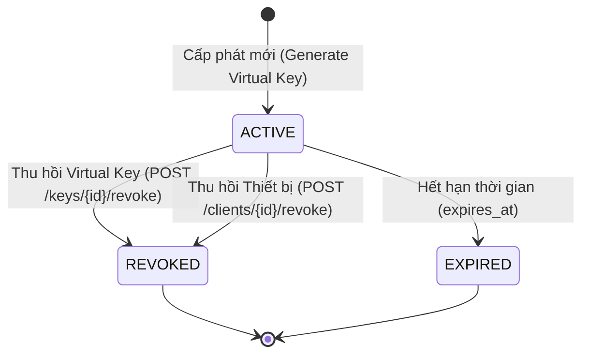

# Phase 1 Data Model & Invariants: Core Security & Gateway Enforcement

**Feature Branch**: `013-gateway-security-enforcement`

---

## 1. Entities & Schema Invariants

### 1.1. RegisteredClient (Domain Entity & DB Model)

Represents an enrolled user device (`USER_DEVICE`) or Docker deployment workload (`APP_SERVER`).

```text
RegisteredClient
├── id: str (ULID, 26 chars)
├── name: str (Human-readable label, e.g. "MacBook Pro - Nguyen Huynh")
├── client_type: ClientType (USER_DEVICE | APP_SERVER)
├── cert_fingerprint: str (SHA-256 hex string, 64 chars)
├── is_revoked: bool (Default: False)
├── created_at: datetime
└── updated_at: datetime
```

**Invariants**:
- Once `is_revoked` is set to `True`, it CANNOT be set back to `False`. Re-enrolling requires registering a new device.
- Any request presenting a certificate whose fingerprint matches a client with `is_revoked == True` is immediately rejected with `HTTP 403 Forbidden`.

---

### 1.2. VirtualAccessKey (Domain Entity & DB Model)

Virtual access token bound to a specific `(RegisteredClient, Project)` tuple.

```text
VirtualAccessKey
├── id: str (ULID, 26 chars)
├── client_id: str (FK -> registered_clients.id)
├── project_id: str (FK -> projects.id)
├── key_hash: str (SHA-256 hash of raw virtual key)
├── key_prefix: str (e.g. "vk_live_...")
├── status: KeyStatus (ACTIVE | REVOKED | EXPIRED)
├── revoked_at: datetime | None
├── expires_at: datetime | None
└── created_at: datetime
```

**State Transitions**:


**Invariants**:
- When `RegisteredClient.is_revoked` becomes `True`, ALL virtual keys associated with `client_id` with `status == ACTIVE` atomically transition to `status = REVOKED` and record `revoked_at = now()`.

---

### 1.3. Upstream Service Verification Contract

Parameters passed from APISIX `identity-binding-filter` to `POST /api/v1/gateway/verify-binding`:

```text
VerifyBindingRequest
├── raw_virtual_key: str (Required)
├── cert_fingerprint: str (Required, 64-char hex)
├── project_id: str (Required)
├── service_id: str | None (Optional)
└── service_slug: str | None (Optional, extracted from /services/{slug}/*)
```

**Resolution & Validation Logic**:
1. Hash `raw_virtual_key` and find `VirtualAccessKeyModel`. Must be `ACTIVE`.
2. Check `key.project_id == project_id`.
3. Check `client.cert_fingerprint.lower() == cert_fingerprint.lower()`.
4. Check `not client.is_revoked`.
5. If `service_slug` is provided:
   - Resolve `UpstreamServiceModel` where `slug == service_slug` and `is_active == True`.
   - Verify `project_allowed_services` contains `(project_id, service.id)`.
6. Return `VerifyBindingResponse(valid=True)`.
